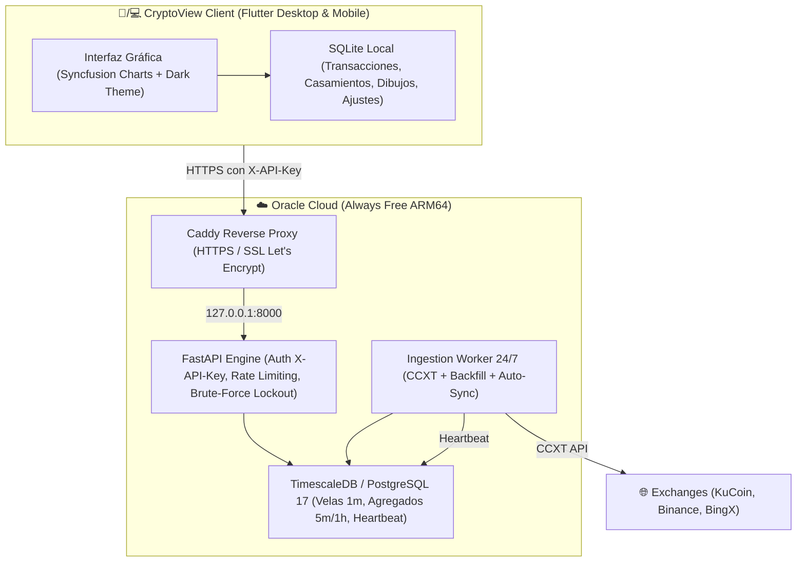

# CryptoView 📈

Plataforma integral de análisis técnico, diario de operaciones y seguimiento de carteras de criptomonedas. Combina una aplicación de escritorio/móvil responsiva de alto rendimiento en **Flutter** con un motor de datos 24/7 en la nube impulsado por **FastAPI**, **PostgreSQL 17** y **TimescaleDB**.

---

## 🏗️ Arquitectura del Sistema

CryptoView implementa un modelo **Offline-First Híbrido**:



1. **Cliente Local (Flutter)**:
   - Persistencia local en SQLite para funcionamiento offline inmediato, dibujos manuales y cálculos de PnL.
   - Sincronización transparente con el servidor en la nube para velas históricas, estado del sistema y salvas completas (.json.gz).
   - Configuración dinámica del servidor y clave en **Ajustes > Servidor Cloud & Motor de Datos 24/7** con prueba de conexión en vivo.

2. **Servidor Cloud (Oracle Cloud OCI)**:
   - **Caddy Reverse Proxy**: Terminación SSL automática con certificado Let's Encrypt en `https://129-146-110-196.sslip.io`. Límite de carga de 50MB y reenvío de IP real.
   - **FastAPI Engine**: API privada con autenticación estricta `X-API-Key`, comparación en tiempo constante (`secrets.compare_digest`), bloqueo temporal tras 5 fallos reiterados y rate limiting (180 req/min).
   - **TimescaleDB (PostgreSQL 17)**: Almacenamiento optimizado de series temporales. Ingestión en velas de 1m y Continuous Aggregates (`candles_5m`, `candles_1h`) para consultas de alta velocidad.
   - **Worker 24/7**: Demonio recolector continuo que realiza avance en tiempo real, backfill progresivo hacia el pasado y auto-sincronización de trades cada 10 minutos.

---

## 🚀 Características Principales

* **Gráficos Financieros Profesionales**: Velas japonesas de alto rendimiento con `syncfusion_flutter_charts`, líneas de compra/venta dinámicas, precio de mercado en vivo y regla de medición porcentual.
* **Motor de Casamiento FIFO**: Registro de compras y ventas con cálculo automático o manual de ganancias realizadas (PnL en USDT y porcentaje).
* **Gestor de Gastos y Bitrefill**: Registro y categorización de retiros y consumos para balance neto real.
* **Seguridad de Grado Bancario**:
  - Claves API de exchanges cifradas en base de datos con **AES-256 (Fernet)**.
  - API protegida contra ataques de fuerza bruta y ataques de canal lateral (timing attacks).
  - Puerto 8000 enlazado estrictamente a `127.0.0.1`, todo el tráfico público pasa por HTTPS Caddy.
* **Copias de Seguridad Bidireccionales**:
  - Salva local `.db` (SQLite).
  - Salva combinada integral `.json.gz` (SQLite local + PostgreSQL TimescaleDB) con compresión GZIP y restauración atómica.

---

## 📂 Estructura del Proyecto

```
CryptoView/
├── backend/                       # Servidor Cloud (FastAPI + TimescaleDB + Caddy)
│   ├── app/                       # Código fuente backend
│   │   ├── routers/               # Endpoints (candles, trades, symbols, keys, health, etc.)
│   │   ├── services/              # Colector 24/7 (collector.py), CCXT, AES-256
│   │   ├── auth.py                # Verificación X-API-Key, rate limit y bloqueo
│   │   └── main.py                # Aplicación FastAPI
│   ├── sql/01_init.sql            # Esquema DDL, hypertables, índices y vistas
│   ├── Caddyfile                  # Configuración HTTPS / Reverse Proxy
│   └── docker-compose.yml         # Orquestación de contenedores en producción
│
├── lib/                           # Aplicación Cliente Flutter
│   ├── core/                      # Servicios de red, base de datos local y temas
│   │   ├── database/              # SQLite DatabaseHelper (cross-platform)
│   │   ├── services/              # CloudApiService (cliente HTTP centralizado)
│   │   └── theme/                 # Paleta AppColors y tipografía
│   ├── features/                  # Módulos de interfaz de usuario
│   │   ├── chart/                 # Pantalla de gráfico e interactividad
│   │   ├── tracker/               # Diario de operaciones y casamientos
│   │   ├── watchlist/             # Lista de seguimiento de pares y favoritos
│   │   ├── exchanges/             # Configuración de claves y sincronizaciones
│   │   └── settings/              # Preferencias visuales y conexión al Servidor Cloud
│   └── main.dart                  # Punto de entrada de la aplicación
│
└── doc/                           # Documentación arquitectónica y contexto
    ├── ARCHITECTURE.md            # Detalles técnicos de capas y diseño
    └── contexto.md                # Referencia rápida de desarrollo y producción
```

---

## 🛠️ Comandos de Desarrollo y Compilación

### Cliente Flutter
```bash
# Obtener dependencias
flutter pub get

# Ejecutar en Windows Desktop
flutter run -d windows

# Compilar ejecutable Release para Windows
flutter build windows --release
# Salida: build/windows/x64/runner/Release/cryptoview.exe
```

### Servidor Backend
```bash
# En el servidor (~/backend):
docker compose build api worker
docker compose up -d

# Ver estado y logs
docker compose ps
docker compose logs -f worker
```
